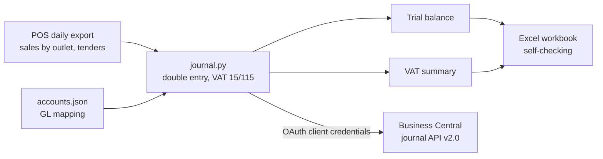

# pos-to-ledger

**Hotel POS takings in, balanced journals out: trial balance, VAT summary and Business Central posting.**

Every morning, a hotel's night auditor or accountant takes the POS end-of-day
reports and turns them into a general journal: sales by outlet, VAT, and how
guests paid (cash, card, charged to their room). This tool does that from the
POS export, refuses to produce a journal that doesn't balance, and posts it to
Microsoft Dynamics 365 Business Central.



## The accounting

For each business day:

| Entry | Account | Amount |
|---|---|---|
| Dr | Cash, card clearing, guest ledger (room charges) | What guests paid, by tender |
| Cr | Sales per outlet and group (restaurant food, pool bar beverage...) | Net sales **excluding** VAT |
| Cr | VAT output | 15/115 of VAT-inclusive net sales |
| Dr/Cr | Cash over/short | Small difference between tenders and sales |

Rules that make it trustworthy:

- **Balances to the cent or nothing is produced.**
- **VAT is calculated on the total**, then sales lines are split so their sum
  plus VAT equals takings exactly; the 1c rounding remainder is placed on the
  largest line instead of drifting.
- **Over/short has a limit** (R50 in the sample config). A bigger difference
  means the POS wasn't closed properly, so the journal stops and says why.
- **Every outlet and tender must be mapped** to a GL account; anything new in the
  POS (a new outlet, a new tender) is reported, never silently dropped.

Real output for the sample day 2026-10-12, where tenders were R20 short:

```
POS-20261012  4100  Restaurant food sales        Cr   13147.82
POS-20261012  4110  Restaurant beverage sales    Cr    5304.35
POS-20261012  4210  Pool bar beverage sales      Cr    3739.13
POS-20261012  2200  VAT output                   Cr    3328.70
POS-20261012  1010  Cash on hand                 Dr    2100.00
POS-20261012  1020  Card clearing                Dr   19300.00
POS-20261012  1100  Guest ledger (room charges)  Dr    4100.00
POS-20261012  6900  Cash over/short              Dr      20.00
Balanced: Dr = Cr = R25520.00
```

## Business Central integration

[`business_central.py`](src/pos_ledger/business_central.py) uses the BC API v2.0:

- **OAuth 2.0 client credentials** through Microsoft Entra ID; the token is cached until shortly before it expires.
- Finds the journal batch by code, **checks for lines with the same document number first**, so a day can't be posted twice.
- Adds lines (debits positive, credits negative), optionally posts the batch with `Microsoft.NAV.post`.
- Retries 429 and 5xx with `Retry-After`; other errors stop with the API's message.
- **Dry run by default.** Nothing is sent without `--send`.

## Run it

```bash
pip install -e ".[dev]"
python -m pytest -q
pos-ledger build 2026-10-11 --xlsx out/2026-10-11.xlsx
pos-ledger post 2026-10-11                 # dry run
```

To send to a Business Central **sandbox**, set `BC_TENANT_ID`, `BC_CLIENT_ID`,
`BC_CLIENT_SECRET`, `BC_COMPANY_ID`, `BC_ENVIRONMENT=Sandbox`, `BC_JOURNAL`, then
`pos-ledger post 2026-10-11 --send`.

## Notes

- The POS export layout is modelled on a hospitality POS "sales by revenue
  centre" and "tenders" report (Simphony-style). Column names live in one module
  ([`pos_export.py`](src/pos_ledger/pos_export.py)) because every site's template differs.
- The VAT summary supports preparing the VAT201 return; it is not a VAT return.
- All outlets, amounts and accounts are fictional.
- The Business Central client is tested against a mocked API. It has not been run against a live tenant.

Built with Claude Code; see [`CLAUDE.md`](CLAUDE.md).

## Licence

MIT
